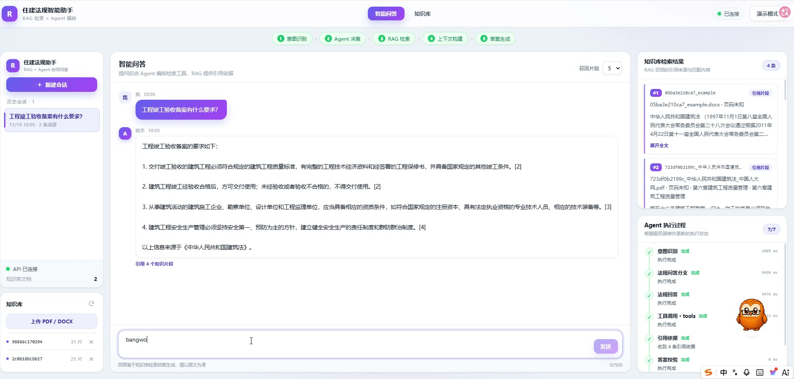
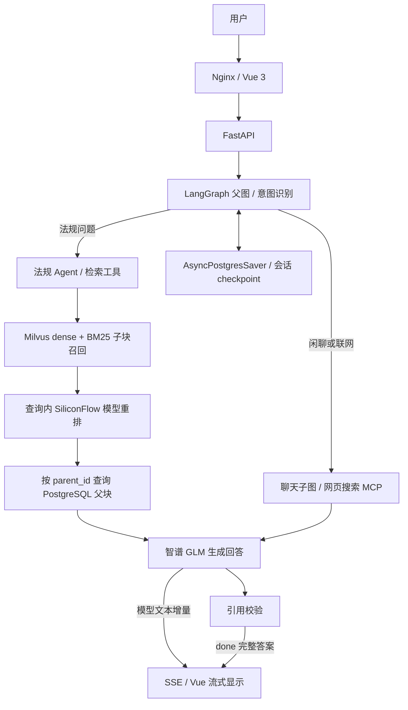

# 住建法规智能助手

基于 **FastAPI + LangChain / LangGraph + Vue 3** 的法规知识库问答项目。支持 PDF / DOCX 入库、父子块检索、Milvus 服务端模型重排、流式回答、引用原文和 PostgreSQL 持久化会话；通过 Docker Compose 与 Nginx 部署到 Linux。

[观看演示视频](./docs/demo.mp4) · [Linux 部署](docs/linux-deploy.md) · [文档初始化](docs/data-pipeline.md) · [SSE 协议](docs/sse-events.md)

## 演示

[](./docs/demo.mp4)

视频长约 2 分 29 秒，展示实际项目操作。若 GitHub 不提供在线播放，可在视频页面点击 **View raw / Download** 下载观看。

## 核心功能

- **统一文档 pipeline**：上传接口与本地初始化脚本共用 MinerU `extract` → Markdown → 父子块切分 → PostgreSQL / Milvus 入库流程；按文件 SHA-256 跳过重复文档。
- **父子块检索**：智谱 Embedding 与 Milvus BM25 混合召回子块，在查询中调用 SiliconFlow 模型重排，再按 `parent_id` 去 PostgreSQL 读取并去重父块。
- **Agent 编排**：父图负责意图识别和回答校验，分别路由到法规问答、聊天子图；检索以 `@tool` 注册，联网请求调用智谱网页搜索 MCP。
- **真实流式输出**：LangGraph v3 模型文本增量通过 FastAPI `EventSourceResponse` 推送到 Vue；终帧返回校验后的完整回答，前端支持暂停、继续、跳过动画和停止请求。
- **可追溯回答**：正文包含来源编号，引用卡片展示文件、章节 / 条款、页码信息和可展开的父块原文；无来源时明确说明缺少依据。
- **持久化会话**：父图与子图共享同一个 `AsyncPostgresSaver`，通过 `thread_id` 隔离会话；提供会话创建、列表、历史和删除接口。
- **执行轨迹**：前端按服务端任务 ID 配对节点 / 工具事件，显示执行状态及事件接收耗时；真实模式与演示模式分开。
- **Linux 部署**：Compose 管理 PostgreSQL、etcd、MinIO、Milvus、API、前端构建任务和 Nginx，数据使用命名卷保存。

## 架构



## 技术栈

| 层次 | 技术 |
| --- | --- |
| 后端 | Python、FastAPI、SQLAlchemy、LangChain 1.x、LangGraph v3 streaming |
| 解析与切分 | MinerU Open API、Markdown 标题切分、递归子块切分 |
| 存储与检索 | PostgreSQL 16、Milvus 2.6.26、LangChain Milvus、BM25、SiliconFlow Rerank |
| 模型与工具 | 智谱 GLM / Embedding、智谱网页搜索 MCP |
| 前端 | Vue 3 Composition API、TypeScript、Vite、Vue Router、Fetch SSE |
| 部署与验证 | Docker Compose、Nginx、unittest / FastAPI TestClient、Node.js 内置测试、vue-tsc |

后端使用 `langchain-milvus==0.3.3` 与 `pymilvus==2.6.9` 的兼容组合。Milvus 自动生成 collection 字段，业务层通过 LangChain 接口操作向量库。

## 快速部署到 Linux

Linux 宿主机需要 Docker 和 Docker Compose，Python 3.14、Node.js 和 Nginx 由容器提供。

```bash
git clone https://github.com/qcc122/smart-regulation.git
cd smart-regulation
cp .env.example .env
```

编辑 `.env`，填写 `ZHIPU_API_KEY`、`SILICONFLOW_API_KEY`、`MINERU_TOKEN`、`POSTGRES_PASSWORD` 和 `MINIO_ROOT_PASSWORD`。MinIO 密码至少 8 位。模板不包含真实凭据；`.env` 不进入版本控制。

```bash
docker compose config --quiet
docker compose up -d
docker compose ps
```

浏览器访问 `http://<Linux-IP>:8080`。首次启动会下载镜像、安装后端依赖和构建前端，等待 API、Milvus 等服务就绪。端口需未被旧服务占用。详细配置、数据卷和日志命令见 [Linux 部署文档](docs/linux-deploy.md)。

SiliconFlow 重排运行在 **Milvus 容器**，Compose 将 Key 注入 `MILVUS_SILICONFLOW_API_KEY`。默认可直连外部服务；需要代理时参照 `.env.example` 配置，并保持内部私有网段绕过代理。

## 本地文档初始化

页面可直接上传 PDF / DOCX，单文件上限 20 MiB。也可在容器中批量导入：

```bash
docker compose exec api mkdir -p /tmp/regulation-seed
docker cp ./your-documents/. smart-regulation-api-1:/tmp/regulation-seed/
docker compose exec api python -m scripts.init_documents /tmp/regulation-seed
```

脚本递归扫描 PDF / DOCX，输出新增、跳过和失败数量。资料目录与 API 密钥由部署者提供，仓库不包含个人上传文件或数据库内容。初始化与数据清理说明见 [文档 pipeline](docs/data-pipeline.md)。

## API

| 方法 | 路径 | 用途 |
| --- | --- | --- |
| GET | `/api/health` | 数据库连通性健康检查 |
| GET | `/api/documents` | 已就绪文档列表 |
| POST | `/api/documents/upload` | 上传并解析入库 |
| DELETE | `/api/documents/{doc_id}` | 删除文档和向量 |
| POST | `/api/chat` | 同步问答 |
| POST | `/api/chat/stream` | 节点、工具、引用、文本增量和终态 SSE |
| GET / POST | `/api/sessions` | 会话列表 / 创建 |
| GET / DELETE | `/api/sessions/{session_id}` | 会话历史 / 删除 |

## 目录

```text
app/
  main.py                 # FastAPI 生命周期内初始化主图
  core/                   # 配置、数据库、日志和异常
  common/                 # 依赖注入、统一响应
  modules/
    document/             # MinerU、切分、入库和上传
    agent/                # 父图、子图、检索工具与向量库
    chat/                 # router.py / service.py（SSE）
    conversation/         # PostgreSQL checkpoint 与会话接口
web/src/                  # Vue 页面、组件与 composables
scripts/                  # 文档初始化和显式重置脚本
tests/                    # 后端测试
web/tests/                # 前端 SSE、会话、轨迹与文字显示测试
deploy/nginx.conf         # 静态文件、API 反代、SSE 与上传配置
docker-compose.yml        # 全栈服务与数据卷
```

## 验证

安装后端依赖后，从项目根目录运行：

```bash
python -m unittest discover -s tests -q
```

前端验证：

```bash
cd web
npm ci
npm test
npm run build
```

本地验证包含 66 项后端测试、7 项前端测试，以及 TypeScript 类型检查和生产构建。测试覆盖文档解析、重复导入、入库补偿、父块展开、引用校验、内容块纯文本提取、会话接口、v3 流式事件、异常终态与断流清理。项目已在 Linux 虚拟机完成部署与功能试用；实机操作见演示视频。
