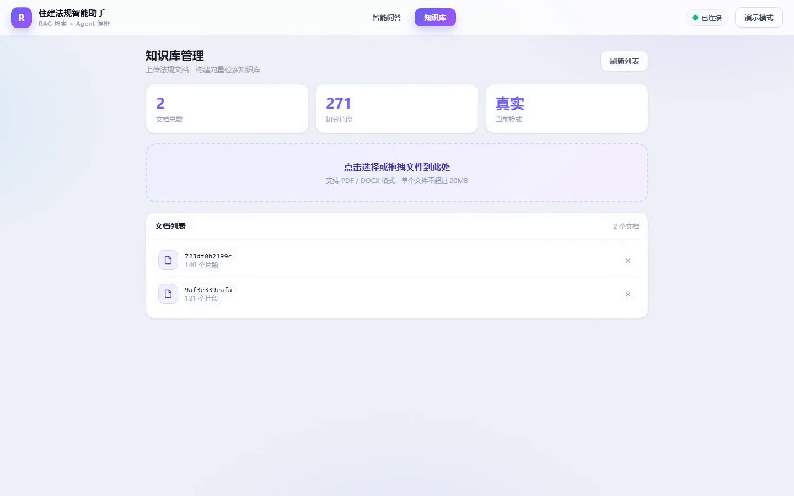
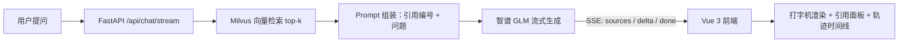

# 住建法规智能助手（RAG 知识库问答系统）

基于 RAG 的住建行业法规智能问答系统：上传法规文档（PDF/DOCX），自动解析、切分并向量化入库；提问时由 Milvus 向量检索召回相关法规片段，交由大模型生成**带引用来源**的回答；前端可视化引用与执行轨迹，支持 SSE 流式逐字输出。

后端（FastAPI）独立开发，前端基于 CodeBuddy AI 编程助手辅助生成——仓库内包含完整的需求拆解、验收测试与工程化实践记录。

## 演示视频

| 桌面端完整流程（56s） | 移动端适配（12s） |
| :---: | :---: |
| [](docs/demo-desktop.mp4) | [](docs/demo-mobile.mp4) |

点击图片播放。桌面端视频包含：流式逐字生成、暂停/继续交互、引用来源展示、Agent 轨迹时间线、知识库上传与删除确认。

## 功能特性

- **知识库管理**：PDF / DOCX 上传 → LangChain 切分 → 智谱 Embedding → Milvus 入库，解析失败自动清理临时文件
- **检索增强问答**：Milvus 向量召回 top-k 片段 → 引用编号拼接 Prompt → GLM 生成回答，前端同步展示引用原文
- **SSE 流式输出**：逐 token 推送（实测单次回答 300+ 帧）；前端打字机引擎以 Unicode 码点消费，支持暂停/继续/跳过/中断，终帧完整性校验保证零丢字
- **执行轨迹可视化**：意图识别 → Agent 决策 → 工具调用（参数可展开）→ 片段召回 → 上下文构建 → 答案生成，状态与耗时实时更新
- **多轮会话**：localStorage 持久化、自动会话标题；后端会话 TTL 过期清理 + 容量上限淘汰
- **响应式界面**：桌面三栏布局 / 移动端底部标签 + 抽屉侧栏，390px~1440px 实机截图验收

## 架构



## 技术栈

| 层 | 技术 |
| --- | --- |
| 后端 | FastAPI、LangChain（Loaders / TextSplitters）、pymilvus、智谱 GLM-4-Flash + Embedding、Docker |
| 前端 | Vue 3、TypeScript、Vite、vue-router、SSE（fetch stream） |
| 验收 | pytest TestClient、Puppeteer 无头浏览器端到端测试 |

## 快速开始

**后端**（需要 Milvus 2.x 与智谱 API Key）：

```bash
pip install -r requirements.txt
copy .env.example .env        # 填入 ZHIPU_API_KEY 等
uvicorn app.main:app --host 127.0.0.1 --port 8000
```

**前端**：

```bash
cd web
npm install --include=dev
npm run dev                   # http://localhost:5173
```

**Docker 部署**（后端）：

```bash
docker build -t smart-regulation .
docker run -d -p 8000:8000 --env-file .env smart-regulation
```
## API 一览

| 方法 | 路径 | 说明 |
| --- | --- | --- |
| GET | `/api/health` | 健康检查 |
| GET | `/api/documents` | 知识库文档列表 |
| POST | `/api/documents/upload` | 上传 PDF/DOCX（≤20MB），解析切分入库 |
| DELETE | `/api/documents/{doc_id}` | 删除文档及其向量片段 |
| POST | `/api/chat` | 同步问答 |
| POST | `/api/chat/stream` | SSE 流式问答（sources → delta* → done） |

## 项目结构

```
├── app/                    # 后端
│   ├── main.py             # FastAPI 入口：6 个接口、SSE 流式、异常处理
│   ├── config.py           # 环境配置（.env 加载）
│   ├── data_loader.py      # 文档解析、切分、批量向量化
│   └── retriever.py        # Milvus 建表 / 增 / 删 / 向量检索
├── web/                    # 前端（Vue 3 + TS + Vite）
│   └── src/
│       ├── views/          # ChatView（问答）/ KnowledgeView（知识库）
│       ├── components/     # 对话、检索、轨迹、侧栏等组件
│       ├── composables/    # 会话管理、全局状态、打字机引擎、Agent 轨迹
│       └── api/rag.ts      # 类型化请求层 + SSE 解析
├── docs/                   # 演示视频与封面图
├── Dockerfile
└── requirements.txt
```

## 已知边界（如实说明）

- Agent 轨迹为前端编排层对真实请求生命周期的记录；后端为线性 RAG 流水线（检索 → 生成），暂无自主工具决策
- 未接入用户鉴权体系，公网部署前需自行添加访问控制
- 会话存储于浏览器 localStorage，跨设备不同步

## 质量验证

- `vue-tsc` 类型检查 + Vite 生产构建通过
- FastAPI TestClient 接口测试：非法 doc_id 拦截（404）、空参数校验（422）
- Puppeteer 无头浏览器端到端：真实后端联调下验证逐字增长、暂停/继续/停止、跳过动画、刷新后状态恢复、上传校验、删除确认、移动端布局等 10+ 场景